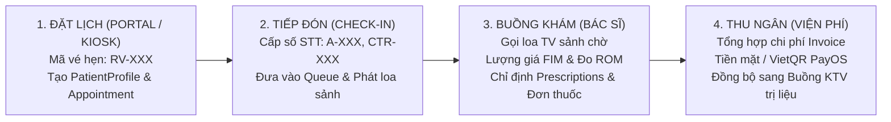
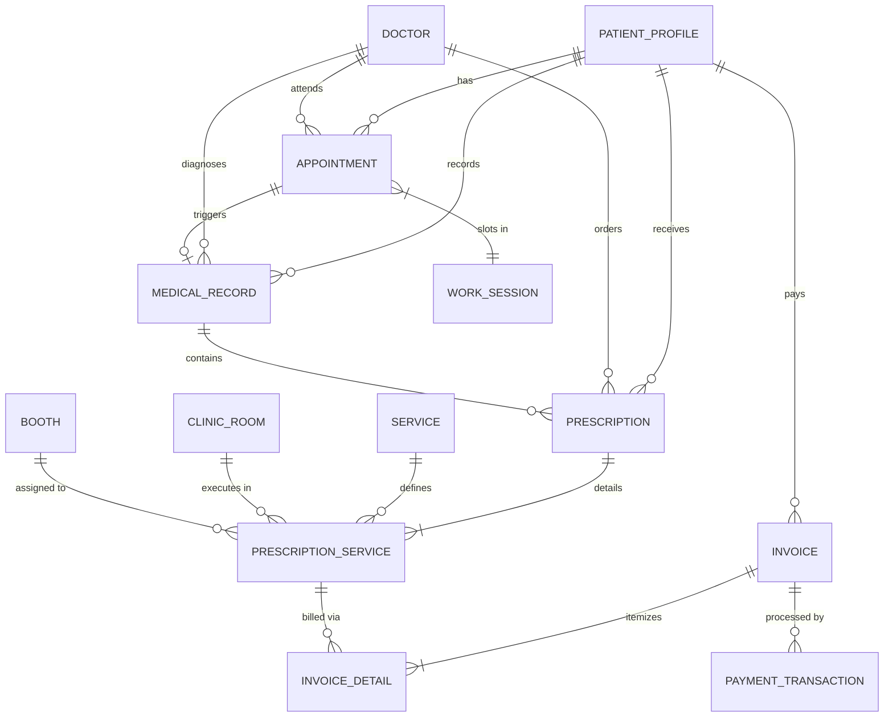

# Kế hoạch Hoạt động & Đồng bộ Dữ liệu Phòng khám Revita (Ease Health)
## Chu trình Khép kín: Đặt lịch → Tiếp đón → Buồng khám → Thu ngân

> **Mã tài liệu:** `PLAN-clinic-workflow-sync`  
> **Phiên bản:** 1.0.0  
> **Hệ thống liên quan:** `revita-be-main` (NestJS, Prisma, PostgreSQL, Redis, MongoDB, WebSocket, PayOS) & `revita-frontend` (Next.js 16 App Router, Tailwind CSS, Turbopack, VieNeu TTS)  
> **Chuyên khoa:** Phục hồi Chức năng & Vật lý Trị liệu (Phòng khám Bác sĩ Thanh Sang • 193 Quang Trung, Đại Lộc, Đà Nẵng)

---

## 1. TỔNG QUAN KIẾN TRÚC & MỤC TIÊU HỆ THỐNG

### 1.1 Mục tiêu
Xây dựng và chuẩn hóa toàn bộ luồng luân chuyển dữ liệu bệnh nhân xuyên suốt 4 chặng tác nghiệp then chốt của phòng khám:
1. **Đặt lịch (Booking)**: Tiếp nhận nhu cầu trực tuyến/tại chỗ, cấp mã hẹn `appointmentCode`, giữ chỗ slot và tạo hồ sơ điện tử `PatientProfile`.
2. **Tiếp đón (Reception / Kiosk Check-in)**: Xác nhận danh tính, quét QR / CCCD / SĐT, phân luồng ưu tiên, cấp số thứ tự vào hàng đợi `BoothQueue` và phát loa sảnh.
3. **Buồng khám (Doctor Clinical Examination)**: Bác sĩ gọi số đồng bộ Loa TV, thực hiện lượng giá chức năng (FIM/ROM), lập bệnh án điện tử `MedicalRecord`, tạo phiếu chỉ định dịch vụ trị liệu `Prescription` và đơn thuốc `MedicationPrescription`.
4. **Thu ngân & Viện phí (Cashier & Payment)**: Tập hợp tự động các dịch vụ/thuốc chỉ định, lập hóa đơn `Invoice`, thanh toán Tiền mặt hoặc VietQR (PayOS webhook), kích hoạt trạng thái dịch vụ đưa bệnh nhân vào buồng tập trị liệu.



---

## 2. BẢN ĐỒ DỮ LIỆU & QUAN HỆ CƠ SỞ DỮ LIỆU (POSTGRESQL & PRISMA)

Hệ thống sử dụng PostgreSQL quản lý dữ liệu giao dịch cốt lõi qua Prisma ORM, kết hợp Redis quản lý hàng đợi tức thời và WebSocket thông báo thời gian thực:



---

## 3. CHI TIẾT 4 CHẶNG TÁC NGHIỆP & CÁCH THỨC LƯU TRỮ DỮ LIỆU

### Chặng 1: Đặt lịch Khám thông minh (Appointment Booking)
* **Tác nhân:** Bệnh nhân (trên Website `/dat-lich`, Kiosk sảnh `/kiosk` hoặc Trợ lý AI `/tro-ly-ai`).
* **Dữ liệu đầu vào:** Họ tên, SĐT, Ngày sinh, Giới tính, Chuyên khoa (`specialtyId`), Bác sĩ (`doctorId`), Khung giờ khám (`workSessionId`, `startTime`, `endTime`), Triệu chứng ban đầu.

#### Cách thức lưu trữ Backend:
1. **Bảng `patient_profiles`**:
   - Nếu bệnh nhân lần đầu: Tạo mới bản ghi với `profileCode` (ví dụ `PAT-2026-089`), `name`, `phone`, `dateOfBirth`, `gender`, `isPregnant`, `isDisabled`.
   - Nếu bệnh nhân cũ (khớp số điện thoại / CCCD): Tái sử dụng `patientProfileId` và cập nhật thông tin mới nhất.
2. **Bảng `appointments`**:
   - Lưu bản ghi mới:
     - `appointmentCode`: Sinh mã ngẫu nhiên dễ nhớ cho bệnh nhân (ví dụ `RV-476`).
     - `patientProfileId`: Khóa ngoại trỏ đến `patient_profiles.id`.
     - `specialtyId`, `doctorId`, `workSessionId`.
     - `date`: Ngày hẹn (UTC timestamp).
     - `startTime`: Ví dụ `"08:30"`, `endTime`: `"09:15"`.
     - `status`: Mặc định `"PENDING"` hoặc `"CONFIRMED"`.
3. **Redis Caching / Distributed Lock**:
   - Khóa slot đặt lịch: `SET appointment:lock:{doctorId}:{date}:{startTime}` trong 10 phút để tránh tình trạng trùng slot (double-booking).
4. **Endpoint Backend phụ trách:**
   - `POST /appointment-booking/appointments` (Body: `BookAppointmentDto`).
   - `GET /appointment-booking/appointments/code/:code` (Tra cứu vé hẹn theo mã).

---

### Chặng 2: Tiếp đón, Phân luồng & Cấp số thứ tự (Reception & Queue)
* **Tác nhân:** Người bệnh đến quầy hoặc tự phục vụ tại Kiosk sảnh (`/kiosk`), Nhân viên tiếp đón (`/dashboard/receptionist`).
* **Hành động:** Quét mã QR vé hẹn (`RV-476`), tra cứu SĐT hoặc bấm "Lấy số thường / Lấy số ưu tiên".

#### Cách thức lưu trữ & Đồng bộ:
1. **Cập nhật `appointments`**:
   - Chuyển `status` từ `"PENDING"` thành `"CONFIRMED"`.
2. **Sinh số thứ tự (Ticket Queue)**:
   - Nếu đã đặt lịch: Cấp số theo buồng bác sĩ hẹn trước (ví dụ `A-001`, `A-002`).
   - Nếu vãng lai/lần đầu: Cấp số quầy tiếp nhận `CTR001-008` hoặc phân luồng buồng khám theo độ ưu tiên (`isPriority: true` cho người già ≥ 75 tuổi, người khuyết tật, phụ nữ mang thai).
3. **Cấu trúc lưu Hàng đợi (Redis & PostgreSQL)**:
   - **PostgreSQL**: Bảng `counters`, `counter_assignments` ghi nhận nhân viên trực quầy.
   - **Redis Sorted Set**: `ZADD queue:booth:{boothId} {priorityScore} {ticketPayload}`.
     - `priorityScore` tính theo: `Timestamp - (isPriority ? 1000000 : 0)`.
4. **WebSocket & Loa phát thanh**:
   - Gateway `clinic-room-websocket.gateway.ts` emit event `new_ticket` và `queue_updated`.
   - Dịch vụ VieNeu TTS trên Kiosk tự động phát loa: *"Xin chào quý khách Nguyễn Văn An, số thứ tự A-001, vui lòng chờ tại sảnh buồng khám 101."*

---

### Chặng 3: Buồng khám Bác sĩ & Kỹ thuật viên (Doctor Clinical & Assessment)
* **Tác nhân:** Bác sĩ PHCN (`/dashboard/doctor`), Kỹ thuật viên PHCN.
* **Hành động:** 
  1. Bấm nút **"Mời bệnh nhân tiếp theo (Loa TV)"**.
  2. Khám lâm sàng, thực hiện lượng giá FIM & đo góc khớp ROM.
  3. Kê phiếu chỉ định các kỹ thuật vật lý trị liệu (Shockwave, TENS, kéo giãn...).
  4. Kê đơn thuốc hỗ trợ điều trị.

#### Cách thức lưu trữ & Đồng bộ:
1. **Phát loa gọi số & Đồng bộ TV Sảnh chờ (`/tv-display`)**:
   - Khi bác sĩ bấm `handleCallNext`:
     - Gateway emit `ticket_called` kèm payload `{ ticketNumber: "A-001", patientName: "NGUYỄN VĂN AN", roomName: "Phòng 101: Khám Lượng giá PHCN" }`.
     - Đồng bộ kênh liên tab `BroadcastChannel("revita_tv_channel")` & `localStorage("revita_tv_latest_call")`.
     - Màn hình TV sảnh chuyển Spotlight, nhấp nháy viền xanh, phát âm thanh VieNeu TTS qua loa sảnh.
2. **Bảng Bệnh án điện tử `medical_records`**:
   - `medicalRecordCode`: Sinh mã bệnh án tự động `MR-2026-XXXX`.
   - `templateId`: Mẫu bệnh án chuyên khoa PHCN (id của `Template`).
   - `patientProfileId`, `doctorId`, `appointmentId`.
   - `status`: `"IN_PROGRESS"` trong lúc khám, `"COMPLETED"` khi kết thúc.
   - **Trường `content` (JSONB) lưu trữ chi tiết**:
     ```json
     {
       "chiefComplaint": "Liệt nửa người phải sau tai biến nhồi máu não tháng thứ 2",
       "vasPainScale": 4,
       "safetyScreening": { "metalImplant": false, "pacemaker": false },
       "fimAssessment": {
         "eating": 6, "grooming": 5, "bathing": 4, "dressingUpper": 5, "dressingLower": 4,
         "toileting": 5, "bladder": 6, "bowel": 6, "bedChairTransfer": 5, "toiletTransfer": 5,
         "tubTransfer": 4, "locomotion": 4, "stairs": 4, "comprehension": 6, "expression": 5,
         "socialInteraction": 6, "problemSolving": 5, "memory": 6,
         "totalScore": 91,
         "classification": "Độc lập có sửa đổi / Trợ giúp tối thiểu"
       },
       "romMeasurements": [
         { "joint": "Khớp Gối Phải", "movement": "Gập gối", "leftAngle": 135, "rightAngle": 85, "normalRange": "0°-135°", "targetAngle": 110 },
         { "joint": "Khớp Vai Phải", "movement": "Gập vai", "leftAngle": 175, "rightAngle": 110, "normalRange": "0°-180°", "targetAngle": 140 }
       ],
       "doctorNotes": "Bệnh nhân tiến triển tốt, bắt đầu có cử động phân ly ngón tay..."
     }
     ```
3. **Bảng Phiếu chỉ định Dịch vụ `prescriptions` & `prescription_services`**:
   - Tạo bản ghi `prescriptions` với `medicalRecordId`, `patientProfileId`, `doctorId`.
   - Với mỗi dịch vụ kỹ thuật được chỉ định (Ví dụ: Shockwave `SW-01`, Kéo giãn `KG-01`):
     - Tạo bản ghi trong `prescription_services`:
       - `prescriptionId`, `serviceId`.
       - `status`: Mặc định `"NOT_STARTED"` (chưa thanh toán).
       - `clinicRoomId`, `boothId`: Buồng máy dự kiến sẽ thực hiện liệu trình.
4. **Bảng Đơn thuốc `medication_prescriptions` & `medication_prescription_items`**:
   - Tạo đơn thuốc liên kết `medicalRecordId`.
   - Mỗi mục thuốc lưu vào `medication_prescription_items` (tên thuốc, liều dùng, số lượng, cách uống).
   - `status`: `"SIGNED"` (Bác sĩ đã ký duyệt).

---

### Chặng 4: Thu ngân, Lập hóa đơn & Quyết toán (Cashier & Payment)
* **Tác nhân:** Thu ngân (`/dashboard/cashier`), Người bệnh hoặc người nhà.
* **Hành động:** Thu ngân tải dữ liệu các chỉ định chưa thanh toán của bệnh nhân, xuất hóa đơn tổng hợp, thu tiền mặt hoặc cung cấp mã VietQR động để quét thanh toán.

#### Cách thức lưu trữ & Đồng bộ:
1. **Bảng Hóa đơn `invoices`**:
   - `invoiceCode`: Mã hóa đơn duy nhất (ví dụ `INV-2026-001`).
   - `patientProfileId`: ID bệnh nhân.
   - `cashierId`: ID thu ngân phụ trách ca trực.
   - `originalTotalAmount`: Tổng tiền gốc các dịch vụ và thuốc.
   - `totalDiscountAmount`: Số tiền miễn giảm / ưu đãi thẻ tích điểm.
   - `totalAmount`: Tiền thực thu.
   - `amountPaid`: Tiền mặt nhận từ khách (nếu trả tiền mặt).
   - `changeAmount`: Tiền thừa trả lại khách.
   - `paymentMethod`: `"CASH"` (Tiền mặt) hoặc `"TRANSFER"` (VietQR / Chuyển khoản).
   - `isPaid`: `false` khi khởi tạo, `true` khi hoàn tất.
   - `paymentStatus`: `"PENDING"` → `"PAID"`.
2. **Bảng Chi tiết hóa đơn `invoice_details`**:
   - Mỗi dịch vụ hoặc thuốc được gắn tương ứng với `serviceId`, `prescriptionServiceId`, `price`.
3. **Bảng Giao dịch Cổng thanh toán `payment_transactions` (Tích hợp PayOS)**:
   - Khi thanh toán bằng VietQR:
     - Backend gọi PayOS API tạo Payment Link / QR Code động.
     - Lưu bản ghi `payment_transactions`:
       - `orderCode`: Mã số đơn hàng PayOS.
       - `amount`: Số tiền chuẩn xác.
       - `qrCode`: Chuỗi base64 hoặc chuỗi chuẩn VietQR NAPAS 247.
       - `status`: `"PENDING"`.
   - Khi người bệnh chuyển khoản thành công:
     - PayOS gửi Webhook tới endpoint: `POST /payos/webhook`.
     - Backend đối chiếu checksum chữ ký `isVerified: true`.
     - Cập nhật `payment_transactions.status = "SUCCEEDED"`.
     - Cập nhật `invoices.isPaid = true` và `invoices.paymentStatus = "PAID"`.
4. **Hiệu ứng Đồng bộ Tự động (Post-Payment Trigger)**:
   - Ngay khi `invoices.isPaid = true`:
     - Toàn bộ các dòng `prescription_services` tương ứng tự động chuyển `status` từ `"NOT_STARTED"` sang `"WAITING"`.
     - Dịch vụ đẩy bệnh nhân vào Hàng đợi của Buồng Kỹ thuật viên trị liệu (`booth-queue`). Kỹ thuật viên tại phòng máy thấy tên bệnh nhân xuất hiện trong danh sách sẵn sàng thực hiện kỹ thuật.

---

## 4. MA TRẬN TRẠNG THÁI (STATE MACHINE) & LUỒNG ĐỒNG BỘ DỮ LIỆU

| Thực thể (Entity) | Chặng 1: Đặt lịch | Chặng 2: Tiếp đón | Chặng 3: Buồng khám | Chặng 4: Thu ngân | Chặng 5: Buồng Trị liệu |
|---|---|---|---|---|---|
| **Appointment** | `PENDING` | `CONFIRMED` | `SERVING` | `COMPLETED` | `COMPLETED` |
| **Queue Ticket** | — | `WAITING` | `SERVING` | `SERVING` | `WAITING_TREATMENT` |
| **MedicalRecord** | — | — | `IN_PROGRESS` → `COMPLETED` | `COMPLETED` | `COMPLETED` |
| **PrescriptionService** | — | — | `NOT_STARTED` | `PENDING` → `WAITING` | `SERVING` → `COMPLETED` |
| **Invoice** | — | — | — | `PENDING` → `PAID` | `PAID` |
| **Loa & TV Display** | — | Kiosk TTS | TV Sảnh Spotlight + TTS | — | TV Buồng tập KTV |

---

## 5. KẾ HOẠCH TRIỂN KHAI THEO PHASE (TASK BREAKDOWN)

### Phase 1: Chuẩn hóa Schema & API Endpoints Backend
- [ ] **Task 1.1**: Rà soát quan hệ Prisma giữa `appointments`, `patient_profiles`, `medical_records`, `prescription_services` và `invoices`. Đảm bảo các foreign key trỏ chính xác và không bị đứt đoạn.
- [ ] **Task 1.2**: Hoàn thiện API `GET /receptionist/queue/snapshot` và `POST /receptionist/call-next` tích hợp đồng bộ trạng thái ticket.
- [ ] **Task 1.3**: Bổ sung endpoint lưu Lượng giá FIM & Đo góc ROM vào trường `content` (JSONB) của `MedicalRecord` tại `POST /medical-record/doctor/save-assessment`.
- [ ] **Task 1.4**: Cấu hình Webhook PayOS tại `POST /payos/webhook` tự động kích hoạt chuyển trạng thái `PrescriptionService.status = "WAITING"` ngay khi thanh toán thành công.

### Phase 2: Đồng bộ Hàng đợi Thời gian thực (WebSocket & Broadcast)
- [ ] **Task 2.1**: Tích hợp sự kiện WebSocket `ticket_called` vào `DoctorWebsocketGateway` để phát sóng khi Bác sĩ bấm "Mời bệnh nhân tiếp theo".
- [ ] **Task 2.2**: Đảm bảo TV Display (`/tv-display`) tiếp nhận mượt mà cả 2 kênh: WebSocket server và Kênh liên tab `BroadcastChannel` (phòng trường hợp mất mạng nội bộ).
- [ ] **Task 2.3**: Kết nối chuẩn hóa giọng đọc VieNeu TTS cho câu xướng gọi tên bệnh nhân theo buồng khám chỉ định.

### Phase 3: Hoàn thiện Luồng Frontend Giao diện
- [ ] **Task 3.1**: Trang Tiếp đón (`/dashboard/receptionist`): Quét mã vé `RV-XXX` từ chặng đặt lịch, tự động hiển thị thông tin và cấp số thứ tự vào đúng buồng khám.
- [ ] **Task 3.2**: Trang Buồng khám (`/dashboard/doctor`): Đọc hàng đợi thực tế của buồng trực từ API, lưu điểm FIM (18 chỉ số) và góc ROM thẳng vào bệnh án điện tử.
- [ ] **Task 3.3**: Trang Thu ngân (`/dashboard/cashier`): Tự động nạp danh sách dịch vụ do Bác sĩ kê, sinh mã VietQR PayOS động để người bệnh quét mã trả tiền.

---

## 6. TIÊU CHÍ NGHIỆM THU (VERIFICATION CHECKLIST)

1. **Tính vẹn toàn dữ liệu (Data Integrity)**:
   - Một ca bệnh đi từ Đặt lịch đến Thu ngân giữ nguyên mã hồ sơ `profileCode` và `patientProfileId`.
   - Không bị thất lạc điểm số FIM hoặc góc đo ROM khi chuyển sang giai đoạn thanh toán hóa đơn.
2. **Tính tức thời (Real-time Latency)**:
   - Bác sĩ bấm "Mời bệnh nhân tiếp theo (Loa TV)", màn hình TV sảnh `/tv-display` phải nhảy số và phát âm thanh trong vòng < 500ms.
   - Người bệnh quét VietQR chuyển khoản, hóa đơn tự động chuyển trạng thái `PAID` và cập nhật tức thì trên màn hình thu ngân mà không cần F5 tải lại trang.
3. **Khả năng dự phòng (Resilience & Fallback)**:
   - Nếu đường truyền internet gián đoạn, Web Speech API của trình duyệt tự động thay thế VieNeu Cloud TTS để không làm gián đoạn việc gọi số tại phòng khám.
   - Cơ chế BroadcastChannel liên tab đảm bảo TV sảnh vẫn nhận được lệnh gọi số ngay cả khi ngắt kết nối WebSocket tạm thời.

---
*Kế hoạch được phê duyệt để triển khai chi tiết cho hệ thống Phòng khám Chuyên khoa Phục hồi Chức năng Bác sĩ Thanh Sang.*
