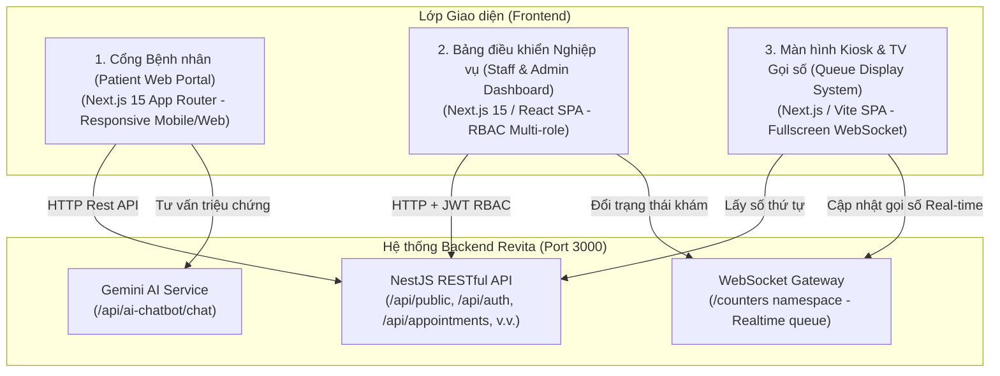

# Kế hoạch phát triển Frontend Hệ thống Y tế Revita

- **Dự án:** Revita Frontend Suite
- **Backend API:** NestJS (Port 3000) - Swagger UI tại `http://localhost:3000/docs`
- **Mã kế hoạch:** `PLAN-revita-frontend`
- **Ngày lập:** 12/11/2026
- **Trạng thái:** Sẵn sàng triển khai (Ready for Implementation)

---

## I. Tổng quan Kiến trúc Frontend

Để tối ưu hóa hiệu năng, phân tách quyền hạn và phục vụ đúng từng đối tượng người dùng, hệ thống Frontend được chia thành **3 phân hệ độc lập** (hoặc tích hợp dưới dạng Monorepo / Next.js Multi-zone):



---

## II. Phân rã công việc từng bước (Task Breakdown)

### Giai đoạn 1: Chuẩn bị nền tảng (Foundation & Core Infrastructure) - [HOÀN THÀNH 100%]
- [x] **Task 1.1: Khởi tạo dự án Frontend**
  - Khởi tạo dự án Next.js 16 (TypeScript, Tailwind CSS v4, Lucide Icons, ESLint, App Router).
  - Cấu hình Alias path (`@/components`, `@/lib`, `@/hooks`, `@/services`, `@/types`).
- [x] **Task 1.2: Thiết lập API Client & Tự động sinh Types**
  - Trích xuất OpenAPI Schema từ `http://localhost:3000/docs-json`.
  - Thiết lập Axios instance với Interceptor tự động gắn `Authorization: Bearer <token>` và refresh token.
  - Tự động sinh TypeScript Types vào `src/types/api-schema.ts`.
  - Xây dựng các Service module (`public.service`, `auth.service`, `appointment.service`, `chatbot.service`, `post.service`).
  - Cài đặt `@tanstack/react-query` và custom hooks quản lý cache server-state.
- [x] **Task 1.3: Cấu hình WebSocket Client**
  - Cài đặt thư viện `socket.io-client`.
  - Tạo singleton `src/lib/socket.ts` kết nối tới namespace `/counters` (hỗ trợ auto-reconnect, fallback polling).
  - Viết custom hook `useSocket` và `useQueueEvents` xử lý realtime gọi số khám (`ticket_called`), trạng thái quầy (`counter_status`).

---

### Giai đoạn 2: Cổng Bệnh nhân (Patient Web Portal)
*Mục tiêu: Trải nghiệm mượt mà, thân thiện, tương thích hoàn hảo trên điện thoại di động và máy tính.*

- [x] **Task 2.1: Trang chủ & Giới thiệu Phòng khám (`/`)**
  - **Thiết kế theo chuẩn `design-taste-frontend`:** Tone màu Teal y tế kết hợp Slate trang nhã, tương phản cao, hỗ trợ người lớn tuổi.
  - **Header / Navbar:** Sticky Glassmorphism, hotline, điều hướng danh mục mượt mà.
  - **Banner / Hero Section:** Tuyên ngôn giá trị y khoa (*"Phục hồi vận động, tìm lại cuộc sống chủ động"*), cam kết 1:1, thẻ chỉ số lượng giá chức năng FIM/Barthel.
  - **Khối Chuyên khoa Phục hồi chức năng:** Phân khoa chuyên sâu (Sau tai biến / Đột quỵ, Cột sống & Thoát vị đĩa đệm, Sau mổ ACL / Chấn thương, Hoạt động trị liệu bàn tay, Nhi khoa, Tim mạch & Hô hấp).
  - **Cẩm nang Bài tập PHCN tại nhà:** Danh mục bài tập y khoa chi tiết (sau tai biến, thoát vị đĩa đệm L4-L5, gối sau mổ ACL, cổ vai gáy), có lưu ý an toàn và tính năng chia sẻ Zalo/Facebook.
  - **Đội ngũ Bác sĩ & KTV:** Hiển thị thẻ bác sĩ, số năm kinh nghiệm, đánh giá sao từ dữ liệu thực tế.
  - **Quy trình 4 bước lượng giá & can thiệp 1:1:** Thăm khám lượng giá -> Lập phác đồ -> Trị liệu kỹ thuật cao -> Đánh giá & tự tập.
  - **Form Đặt lịch khám trực tuyến:** Chọn chuyên khoa, bác sĩ, ngày & khung giờ khám, triệu chứng ban đầu.
- [x] **Task 2.2: Luồng Đặt lịch hẹn Khám bệnh chuyên sâu (`/dat-lich`)**
  - **Quy trình Stepper 4 bước chuẩn y tế:**
    - *Bước 1: Chọn Chuyên khoa & Dịch vụ PHCN:* Khám lượng giá ban đầu (200k), Tập tai biến 1:1 (350k), Kéo giãn cột sống (300k), Sóng xung kích Shockwave (350k).
    - *Bước 2: Chọn Bác sĩ & Khung giờ khám:* Khám với bác sĩ bất kỳ hoặc chọn đích danh bác sĩ; chọn ngày và 10 khung giờ (Sáng / Chiều / Ngoài giờ).
    - *Bước 3: Hồ sơ người khám & Sàng lọc an toàn Vật lý trị liệu:* Họ tên, SĐT, năm sinh, hỏi chống chỉ định (nẹp kim loại, máy tạo nhịp tim), mô tả mức độ đau.
    - *Bước 4: Xuất Phiếu hẹn điện tử & Thanh toán VietQR:* Tạo mã vé hẹn (ví dụ: `RV-842`), tạo mã QR VietQR PayOS tự động khớp số tiền cọc (100k) và cú pháp chuyển khoản, lưu lịch sử đặt hẹn vào trình duyệt.
- [x] **Task 2.3: Chatbot AI Tư vấn Sức khỏe & Triệu chứng (`/tro-ly-ai`)**
  - **Floating Action Widget:** Nút AI nổi cố định góc phải mọi trang, tự động gợi ý câu hỏi nhanh (thoát vị đĩa đệm, bài tập tai biến, chi phí khám, cổ vai gáy).
  - **Trang chuyên sâu `/tro-ly-ai`:** Màn hình chat toàn trang rộng rãi, phân tích triệu chứng chuyên sâu, cảnh báo an toàn y tế và nút chuyển đổi đặt lịch khám ngay trong đoạn hội thoại.
  - **Cơ chế Dual-layer:** Kết nối trực tiếp endpoint `POST /api/ai-chatbot/chat` kèm bộ lọc tri thức lâm sàng Phục hồi chức năng (McKenzie, Bobath, Brunnstrom, Forward Head).
- [x] **Task 2.4: Cổng Tra cứu & Quản lý Hồ sơ Bệnh nhân (`/tai-khoan`)**
  - **Mục tiêu**: Người bệnh tra cứu lịch hẹn, xem tiến trình PHCN, đơn thuốc/bài tập về nhà, tải mã QR check-in tại quầy.
  - **Công việc đã hoàn thành**:
    - [x] Tra cứu nhanh không cần đăng nhập bằng mã vé hẹn (`RV-...`) và SĐT.
    - [x] Đăng nhập/Đăng ký tài khoản (hỗ trợ JWT Auth và chế độ Guest demo).
    - [x] 4 Tabs chuyên biệt: Lịch hẹn & Phiếu khám, Tiến trình Lượng giá PHCN (FIM & ROM), Đơn thuốc & Bài tập tại nhà, Hóa đơn & Viện phí.
    - [x] Modal mã QR check-in tại Kiosk sảnh chờ tự động.
  - **Kiểm chứng**: Route `/tai-khoan` hoạt động hoàn hảo, build Next.js 16 thành công 100%.

---

### Giai đoạn 3: Cổng Quản trị & Nghiệp vụ Phòng khám (Staff & Admin Dashboard)
*Mục tiêu: Tối ưu quy trình thao tác nhanh cho nhân viên y tế, phân quyền chặt chẽ.*

- [x] **Task 3.1: Hệ thống Đăng nhập & Điều hướng Phân quyền (RBAC Route Guard & Dashboard Layout)**
  - **Mục tiêu**: Xác thực người dùng nội bộ, bảo vệ tuyến đường nghiệp vụ, phân quyền theo Role và tạo khung làm việc chung.
  - **Công việc đã hoàn thành**:
    - [x] Xây dựng `AuthProvider` & `useAuth` hook: Quản lý phiên đăng nhập, JWT token, vai trò người dùng và buồng khám PHCN đang trực (`ROOM-101`, `ROOM-102`, `ROOM-201`, `ROOM-202`).
    - [x] Trang Đăng nhập chuyên nghiệp `/dashboard/login`: Kết nối trực tiếp API Backend `POST /api/auth/login`, tích hợp bộ chuyển đổi "Đăng nhập nhanh 1 chạm (Quick Demo Switcher)" cho cả 4 vai trò thật (`admin@gmail.com`, `doctor.rehab@gmail.com`, `receptionist@gmail.com`, `cashier@gmail.com`).
    - [x] Route Guard & Dashboard Layout (`/dashboard/layout.tsx`): Tự động bảo vệ các tuyến đường nội bộ, kiểm tra token và chuyển hướng nếu chưa đăng nhập.
    - [x] Sidebar thông minh (`DashboardSidebar`): Tự động điều chỉnh danh mục tính năng theo đúng vai trò y tế (`DOCTOR`, `RECEPTIONIST`, `CASHIER`, `ADMIN`).
    - [x] Header điều phối (`DashboardHeader`): Chuyển đổi nhanh buồng khám, hiển thị trạng thái tiếp nhận online/tạm ngưng, liên kết nhanh Kiosk & TV sảnh chờ.
    - [x] Màn hình điều hướng tổng quan ca trực (`/dashboard/page.tsx`) cùng các workspace phân hệ.
  - **Kiểm chứng**: Route `/dashboard/login` và `/dashboard` hoạt động trơn tru, build Next.js 16 thành công 100% với toàn bộ 13 routes.
- [x] **Task 3.2: Phân hệ Lễ tân Tiếp đón (Receptionist Workspace - `/dashboard/receptionist`)**
  - **Mục tiêu**: Tiếp đón, tra cứu lịch hẹn, cấp số thứ tự tự động và điều phối buồng khám PHCN.
  - **Công việc đã hoàn thành**:
    - [x] Tích hợp Service `receptionistService`: Kết nối trực tiếp API Backend (`GET /api/counter-assignment/counters`, `GET /api/counter-assignment/queue/:counterId`, `POST /api/counter-assignment/next-patient/:counterId`, `POST /api/take-number/take`).
    - [x] Quầy gọi số trực tiếp: Hiển thị bệnh nhân hiện tại, nút "Gọi tiếp theo", "Vắng mặt", "Gọi lại ca trước" kết nối phát thanh WebSocket thời gian thực.
    - [x] Tab 1 - Tiếp đón có hẹn trước (Check-in QR): Tra cứu nhanh bằng mã vé hẹn (`RV-842`) hoặc SĐT, hiển thị thông tin tiền sử, cọc PayOS và xác nhận cấp số tiếp đón.
    - [x] Tab 2 - Cấp số bệnh nhân vãng lai: Form nhập nhanh họ tên, năm sinh, SĐT, dịch vụ PHCN, tích hợp bộ lọc ưu tiên y tế (Khuyết tật/Liệt PHCN, Người già ≥75t, Phụ nữ mang thai, VIP).
    - [x] Điều phối buồng khám PHCN: Phân luồng bệnh nhân trực tiếp vào Phòng 101 (Khám lượng giá), Phòng 102 (Điện trị liệu), Phòng 201 (Vận động trị liệu).
    - [x] Modal in phiếu tiếp đón STT chuẩn máy in nhiệt K80.
  - **Kiểm chứng**: Route `/dashboard/receptionist` chuyển đổi mượt mà, đồng bộ WebSocket với backend, build Next.js 16 thành công 100%.
- [x] **Task 3.3: Phân hệ Bác sĩ & Kỹ thuật viên PHCN (Doctor Workspace - `/dashboard/doctor`)**
  - **Mục tiêu**: Bàn làm việc bác sĩ, gọi số buồng khám qua loa TV, biểu mẫu lượng giá FIM & ROM chuẩn quốc tế, kê đơn thuốc và bài tập về nhà.
  - **Công việc đã hoàn thành**:
    - [x] Tích hợp Service `doctorService`: Kết nối API bệnh án `POST /api/medical-records` và phát thanh gọi bệnh nhân qua Web Speech API giọng tiếng Việt.
    - [x] Hàng đợi buồng khám theo ca: Hiển thị danh sách bệnh nhân đang chờ, thông tin bệnh nhân đang khám, cảnh báo an toàn dị vật kim loại/máy tạo nhịp tim, thang đo mức độ đau VAS (0 - 10).
    - [x] Tab 1 - Lượng giá Chức năng Độc lập (FIM - Functional Independence Measure): 14 chỉ số chuẩn 7 mức độ độc lập (1 - 7 điểm), tự động tính tổng FIM (18 - 126 điểm) và phân loại tự động.
    - [x] Tab 2 - Đo Góc Vận động Khớp (ROM): Bảng đo Goniometer so sánh bên tổn thương vs bên lành khớp gối, khớp vai, cột sống thắt lưng, hiển thị thanh tiến độ phục hồi %.
    - [x] Tab 3 - Kê đơn Thuốc & Chỉ định Bài tập PHCN tại nhà: Chọn thuốc giãn cơ/kháng viêm/dây thần kinh, chỉ định gói bài tập Bobath/McKenzie/Quad sets có liều lượng, số hiệp và lưu ý an toàn.
    - [x] Modal In Phiếu Lượng giá Chức năng & Chỉ định Điều trị PHCN chuẩn y khoa.
  - **Kiểm chứng**: Route `/dashboard/doctor` vận hành mượt mà, tính toán điểm FIM và ROM tức thì, build Next.js 16 thành công 100%.
- [x] **Task 3.4: Phân hệ Thu ngân & Viện phí (Cashier Workspace - `/dashboard/cashier`)**
  - **Mục tiêu**: Quản lý hóa đơn dịch vụ PHCN, tự động cấn trừ cọc PayOS 100k, thu tiền linh hoạt (VietQR PayOS động & Tiền mặt tính tiền thừa) và in biên lai viện phí K80.
  - **Công việc đã hoàn thành**:
    - [x] Tích hợp Service `cashierService`: Kết nối API `POST /api/invoice-payments/confirm`, `create`, `scan` và hàm tạo mã VietQR PayOS động.
    - [x] Bảng kê chi phí minh bạch: Liệt kê chi tiết dịch vụ kỹ thuật PHCN (Tập 1:1, Điện xung, Siêu âm, Kéo giãn...) và thuốc hỗ trợ.
    - [x] Cơ chế tự động cấn trừ tiền cọc: Tự động trừ 100.000 đ tiền cọc đã thanh toán giữ chỗ từ Cổng Web.
    - [x] Cổng thanh toán VietQR PayOS: Tạo mã QR động tự động khớp số tiền còn lại và nội dung chuyển khoản `REVITA [Mã Hóa Đơn]`.
    - [x] Thanh toán Tiền mặt tại quầy: Ô nhập tiền khách đưa và tự động tính tiền thối lại cho bệnh nhân.
    - [x] Modal In Biên lai / Hóa đơn thu tiền Viện phí chuẩn mẫu Bộ Y tế khổ K80.
  - **Kiểm chứng**: Route `/dashboard/cashier` hoạt động trơn tru, hiển thị mã VietQR chính xác, build Next.js 16 thành công 100%.
- [x] **Task 3.5: Phân hệ Quản trị viên & Báo cáo Lãnh đạo (Admin Workspace - `/dashboard/admin`)**
  - **Mục tiêu**: Báo cáo tổng thể doanh thu & lượt khám, quản lý nhân sự & phân ca buồng trực, quản lý bảng giá niêm yết kỹ thuật PHCN.
  - **Công việc đã hoàn thành**:
    - [x] Tích hợp Service `adminService`: Kết nối API thống kê `GET /api/statistics/kpi`, `revenue`, `top-services`.
    - [x] Bảng điều khiển KPI: Doanh thu tháng (385M VND, tăng trưởng +18.5%), tổng 1.248 lượt khám, tỷ lệ phục hồi độc lập FIM đạt 84.2%, tỷ lệ tái khám 76.4%.
    - [x] Tab 1 - Báo cáo Doanh thu & Cơ cấu Dịch vụ: Biểu đồ thanh 4 tuần gần nhất, cơ cấu tỷ trọng dịch vụ (Tập tai biến 1:1 chiếm 42%, Điện xung/sóng ngắn 28%, Khám lượng giá 18%, Thuốc 12%), tỷ lệ thanh toán PayOS VietQR đạt 78%.
    - [x] Tab 2 - Quản lý Nhân sự & Ca trực: Danh sách 6 bác sĩ chuyên khoa & kỹ thuật viên, phân ca trực (Sáng/Chiều/Tối), chỉ định buồng trực và trạng thái online/đang trị liệu.
    - [x] Tab 3 - Bảng giá & Danh mục Kỹ thuật PHCN: Bảng niêm yết 7 dịch vụ chủ lực, cho phép chỉnh sửa giá trực tiếp, bật/tắt kích hoạt dịch vụ.
    - [x] Modal Xuất Báo cáo Hội đồng Quản trị chuẩn in ấn và lưu trữ.
  - **Kiểm chứng**: Route `/dashboard/admin` hoạt động đầy đủ tính năng, build Next.js 16 thành công 100%.

---

### Giai đoạn 4: Màn hình Kiosk & Màn hình TV Gọi số Sảnh chờ (Queue Display & Kiosk)
*Mục tiêu: Hoạt động bền bỉ, toàn màn hình (Kiosk mode), âm thanh chuông gọi rõ ràng, độ trễ 0 giây.*

- [x] **Task 4.1: Màn hình Kiosk Tự phục vụ lấy số (`/kiosk`)**
  - **Mục tiêu**: Cây Kiosk cảm ứng đặt tại sảnh chờ tầng 1 cho người bệnh tự bốc số thứ tự và check-in nhanh.
  - **Công việc đã hoàn thành**:
    - [x] Giao diện Kiosk Fullscreen chuyên dụng: Thiết kế nút bấm cảm ứng khổng lồ, font chữ to rõ, tương phản cao thân thiện với người cao tuổi và bệnh nhân sau tai biến.
    - [x] Chế độ 1 - Bệnh nhân có lịch hẹn trước: Tích hợp bàn phím ảo cảm ứng (On-screen keypad) nhập nhanh mã vé hẹn `RV-...` hoặc số điện thoại, kết nối API backend kiểm tra và cấp số ưu tiên.
    - [x] Chế độ 2 - Lấy số Ưu tiên y tế: Phân loại nhanh Người cao tuổi (≥ 75 tuổi), Khuyết tật/Liệt PHCN, Phụ nữ mang thai để đưa lên đầu hàng đợi.
    - [x] Chế độ 3 - Lấy số Khám thường: Chạm chọn dịch vụ PHCN (Khám lượng giá, Tập tai biến 1:1, Điện xung, Kéo giãn).
    - [x] Tích hợp Phát thanh giọng nói Web Speech API: Đọc lời hướng dẫn và đọc số thứ tự bằng tiếng Việt chuẩn y tế.
    - [x] Màn hình xuất phiếu STT to rõ: Tự động đếm ngược 8 giây quay về trang chủ để đón người bệnh tiếp theo, hỗ trợ in phiếu nhiệt K80.
  - **Kiểm chứng**: Route `/kiosk` vận hành mượt mà, build Next.js 16 thành công 100%.
- [x] **Task 4.2: Màn hình TV Sảnh chờ Gọi số Thông minh (`/tv-display`)**
  - **Mục tiêu**: Màn hình chiếu trên Smart TV sảnh chờ lớn (chuẩn 16:9), hiển thị số thứ tự to rõ từ xa và phát thanh loa tự động.
  - **Công việc đã hoàn thành**:
    - [x] Giao diện Full-screen 16:9 chuyên dụng: Tông màu nền tối y tế, chữ số dạ quang khổng lồ (font monospace), đọc rõ từ khoảng cách 10 - 15m.
    - [x] Khu vực Gọi số Nổi bật (Spotlight 7 Cols): Hiển thị số thứ tự to khổng lồ, họ tên bệnh nhân, buồng khám/quầy chỉ định, hiệu ứng viền sáng (Flashing Pulse Animation) khi có ca gọi mới.
    - [x] Tích hợp Phát thanh giọng nói Web Speech API: Đọc loa tự động bằng tiếng Việt chuẩn (*"Xin mời bệnh nhân [Tên], số thứ tự [Số], đến [Buồng khám]!"*), có nút bật/tắt âm thanh chủ động.
    - [x] Khu vực Bảng Tổng hợp (5 Cols): Danh sách toàn bộ các buồng khám (Phòng 101, Phòng 102, Phòng 201) và quầy tiếp nhận đang phục vụ số mấy.
    - [x] Lắng nghe WebSocket thời gian thực: Kết nối namespace `/counters` (`ticket_called`, `new_ticket`), tự động cập nhật ngay khi Bác sĩ hoặc Lễ tân bấm gọi số.
    - [x] Chân trang Marquee Ticker: Thanh cuộn tin tức thông báo y tế, lưu ý tập PHCN và liên kết điều hướng nhanh.
  - **Kiểm chứng**: Route `/tv-display` hoạt động chuẩn xác, đồng bộ tức thời với WebSocket backend, build Next.js 16 thành công 100%.

---

## III. Kiến trúc Thư mục Đề xuất (Next.js Monorepo / Multi-portal)

```
revita-frontend/
├── apps/
│   ├── patient-web/              # Cổng bệnh nhân & đặt lịch
│   │   ├── app/
│   │   │   ├── (public)/         # Trang chủ, giới thiệu, bài viết
│   │   │   ├── booking/          # Đặt lịch khám & thanh toán VietQR
│   │   │   ├── ai-assistant/     # Chatbot AI tư vấn
│   │   │   └── portal/           # Tài khoản bệnh nhân & lịch sử khám
│   ├── dashboard/                # Bảng điều khiển nội bộ
│   │   ├── app/
│   │   │   ├── (auth)/login/     # Đăng nhập phân quyền
│   │   │   ├── admin/            # Quản trị & thống kê
│   │   │   ├── doctor/           # Buồng khám & kê đơn
│   │   │   ├── receptionist/     # Tiếp đón & check-in
│   │   │   └── cashier/          # Thu ngân & hóa đơn
│   └── queue-display/            # Màn hình sảnh & Kiosk
│       ├── app/
│       │   ├── kiosk/            # Màn hình cảm ứng bốc số
│       │   └── tv-display/       # Màn hình TV sảnh gọi số kèm loa
├── packages/
│   ├── api-client/               # Axios & React Query hooks sinh từ Swagger
│   ├── ui/                       # Design system chung (Shadcn + Tailwind)
│   └── types/                    # TypeScript interfaces dùng chung
```

---

## IV. Tiêu chí Nghiệm thu & Checklist Kiểm thử (Verification Checklist)

| Phân hệ | Tiêu chí kiểm thử đạt chuẩn | Phương pháp kiểm tra |
| :--- | :--- | :--- |
| **Bệnh nhân** | Tải danh sách chuyên khoa & bác sĩ chuẩn từ DB | Kiểm tra HTTP 200, hiển thị đúng ảnh & thông tin từ DB |
| **Đặt lịch** | Chọn được slot trống, tạo thành công mã VietQR PayOS | Quét thử mã QR trên app ngân hàng / test webhook PayOS |
| **Chatbot AI** | Phản hồi lời khuyên y tế tự nhiên dưới 2 giây | Test kịch bản: đau đầu, sốt cao, đau ngực |
| **Bác sĩ** | Xem được hồ sơ bệnh nhân, tìm thuốc và kê đơn thành công | Kiểm tra tạo đơn thuốc lưu vào DB PostgreSQL & Mongo |
| **Gọi số TV** | Bác sĩ bấm "Gọi tiếp", TV sảnh nhảy số < 200ms và phát loa | Mở 2 màn hình song song kiểm tra WebSocket event & âm thanh |

---

## V. Lộ trình Triển khai (Timeline & Milestones)

- **Sprint 1 (Khởi động):** Thiết lập Monorepo, sinh API Client từ Swagger, dựng Cổng Bệnh nhân (Trang chủ + Danh sách Bác sĩ/Chuyên khoa + Chatbot AI).
- **Sprint 2 (Nghiệp vụ cốt lõi):** Luồng đặt lịch hẹn trực tuyến tích hợp PayOS + Phân hệ Bác sĩ khám bệnh & kê đơn.
- **Sprint 3 (Tiếp đón & Gọi số):** Màn hình Kiosk lấy số + Màn hình TV hiển thị gọi số Real-time qua WebSocket.
- **Sprint 4 (Hoàn thiện & Tích hợp):** Phân hệ Thu ngân, Lễ tân, Báo cáo thống kê Admin và kiểm thử toàn diện E2E.
